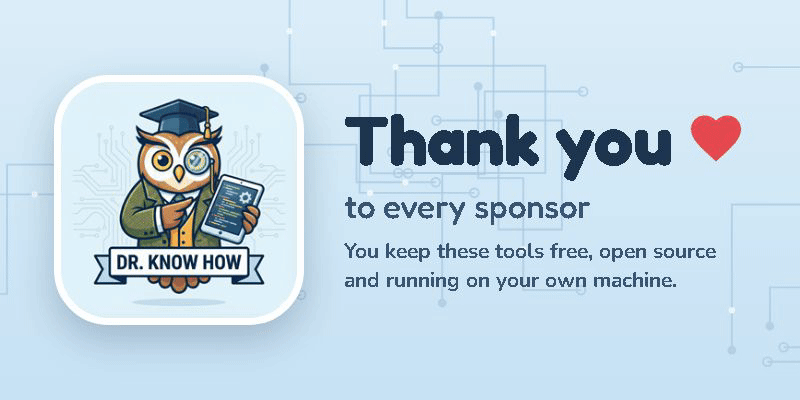

### Hi, I'm Dr. Know How

I'm not a software engineer. I'm a heavy AI user who builds the tools I wish already
existed, and I use every one of them daily. Everything here is free, open source and
local-first: no telemetry, and your keys and text stay on your machine.

| Project | What it does |
|---|---|
| [C3 · Code Context Control](https://github.com/drknowhow/code-context-control) | Local MCP code intelligence for Claude Code, Codex, Gemini and other coding agents. `pip install code-context-control` |
| [ConciseClaude](https://github.com/drknowhow/ConciseClaude) | A Claude Code plugin for answer-first replies. In my benchmark, Opus replies came out 71% shorter and 30% cheaper. |
| [Claude Usage for Android](https://github.com/drknowhow/claude-usage-android) | Your Claude session and weekly limits in the notification shade, a widget, and the status bar on stock Android 16. |
| [R3write](https://github.com/drknowhow/R3write) | Inline AI rewrite for Windows: select text in any app, press Ctrl+Alt+G, paste the result back. |
| [Sentinel](https://github.com/drknowhow/Sentinel) | A Chrome extension that records, replays and documents browser flows, driven by Claude or Cursor through 50+ MCP tools. |

### Support

If one of these tools saves you time, you can [sponsor the work](https://github.com/sponsors/drknowhow).
Any amount pays for model runs and testing, and keeps everything free.
